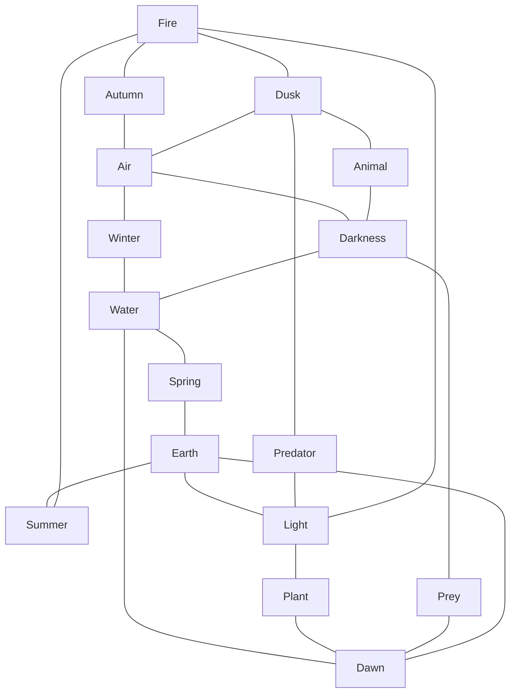

# Aspects of Nature

The fey see themselves as defenders of Nature and representatives of all that she is. Most fey are more subdued in their approach and refrain from neglecting one portion of nature to support another. Other fey instead focus their attention on a particular element, season, or facet of Nature’s being. These fey feel that it is their place in life to champion a certain portion of Nature, and as a result of their efforts gain magical benefits and exhibit a physical manifestation, known as an ‘aspect’, of their associated influence power. Although not exclusively limited to fey creatures, few mortal creatures understand or agree with the philosophies related to Aspects.

Aspects of Nature are closely related to prestige races in that they both require a feat to gain access to them, and they both physically change a creature’s physiology to provide benefits. Aspects of Nature, however, are physical changes that provide low-powered bonuses in exchange for equally low penalties.

Aspects of Nature are a physical representation of a part of Nature. Light and Darkness are two opposing forces that may seem aligned with the Seelie and Unseelie courts, but actually these forces are more aligned with the natural cycles of day and night, just as the seasons represented are part of the yearly natural cycle.

A creature can only have one Aspect of Nature at any given time. Some class abilities provide a way to supernaturally add additional Aspects of Nature, but this is the exception to the rule.

In addition to the bonuses and penalties, there are physical, emotional, and magical manifestations associated with aspects of Nature. A creature’s skin and hair change color to a hue complimentary to the Aspect of Nature chosen. Their taste in clothing changes as well; they begin wearing clothes dyed in colors and made of materials associated with their chosen Aspect.

For example, a feeorin sorcerer decides to champion the season autumn. After taking the Nature’s Aspect feat, his skin turns a reddish-hued sepia tone, and his hair becomes a mottled orange and brown pattern. His hair also grows thicker and almost twig-like in some places. This change grants him a +3 circumstance bonus on [[rangoric-srd/skills/Stealth|Stealth]] checks in natural surroundings during autumn while leaves shift to vivid colors. Upon choosing the role of a Fey of Autumnal Splendor, he gains a +1 resistance bonus to Reflex saves and a –1 resistance penalty to Fortitude saves.

Any spells cast by the character are also slightly affected by the Aspect of Nature, shifting in their visual or audible effects slightly. These subtle change can help those feats work more effectively (add +1 to the DC of any Magic skill check made to identify an affected spell; see [[rangoric-srd/skills/Identifying Magic|Identifying Magic]]). For example, if that feeorin casts the spell *[[rangoric-srd/spells/Magic Missile|magic missile]]*, it still appears as a missile of magical energy darting from his fingertips. His Aspect of the Autumn, however, could manifest a whooshing noise similar to rustling leaves with the normally silent spell, or autumn leaves themselves might seem to stream behind the *magic missile* as it streaks toward its target.

Given the strong feelings that draw a fey to champion an Aspect of Nature, it is not uncommon for a fey to retain a particular aspect for his entire life. Some even become so representative of their chosen Aspect that they become inseparably associated with it.

## The Aspects

- [[rangoric-srd/races/aspects-of-nature/Aspect of the Air|Aspect of the Air]]
- [[rangoric-srd/races/aspects-of-nature/Aspect of the Animal|Aspect of the Animal]]
- [[rangoric-srd/races/aspects-of-nature/Aspect of the Autumn|Aspect of the Autumn]]
- [[rangoric-srd/races/aspects-of-nature/Aspect of the Darkness|Aspect of the Darkness]]
- [[rangoric-srd/races/aspects-of-nature/Aspect of the Dawn|Aspect of the Dawn]]
- [[rangoric-srd/races/aspects-of-nature/Aspect of the Dusk|Aspect of the Dusk]]
- [[rangoric-srd/races/aspects-of-nature/Aspect of the Earth|Aspect of the Earth]]
- [[rangoric-srd/races/aspects-of-nature/Aspect of the Fire|Aspect of the Fire]]
- [[rangoric-srd/races/aspects-of-nature/Aspect of the Light|Aspect of the Light]]
- [[rangoric-srd/races/aspects-of-nature/Aspect of the Plant|Aspect of the Plant]]
- [[rangoric-srd/races/aspects-of-nature/Aspect of the Predator|Aspect of the Predator]]
- [[rangoric-srd/races/aspects-of-nature/Aspect of the Prey|Aspect of the Prey]]
- [[rangoric-srd/races/aspects-of-nature/Aspect of the Spring|Aspect of the Spring]]
- [[rangoric-srd/races/aspects-of-nature/Aspect of the Summer|Aspect of the Summer]]
- [[rangoric-srd/races/aspects-of-nature/Aspect of the Water|Aspect of the Water]]
- [[rangoric-srd/races/aspects-of-nature/Aspect of the Winter|Aspect of the Winter]]

### How the Aspects Link

Each element sits between two seasons and two times of day; each time of day also links the two creature aspects beside it. An aspect can change to any aspect linked to it by a line.

## Adopting an Aspect of Nature

Now that you know about aspects, here’s how your characters can adopt them.

**Step One:** Obtain the feat [[rangoric-srd/feats/Nature's Aspect|Nature's Aspect]].

**Step Two:** Choose an Aspect to follow. If you wish to change to another Aspect of Nature, you must follow the links in the [[#How the Aspects Link|diagram of the aspects]]: an aspect can change to any aspect linked to it by a line, so changing to one further away passes through the aspects between. You must spend at least one week per facet you have in each Aspect between your current and final desired Aspects. For example, if an Autumn-aspected character wishes to change his Aspect to Water, he must spend one week with his new Aspect of the Air before changing to the Aspect of Winter. One week after that change, he can abandon Aspect of Winter for Aspect of the Water.

**Step Three:** Spend 500 XP. The initial transformation takes place over the course of a whole day and the character can access the abilities of the Aspect at the end of those 24 hours. The visual changes in the character also occur gradually and manifest fully after one day.

**Step Four:** Choose any one facet of the Aspect. There is no set order in which to adopt facets, nor are there additional prerequisites for each facet. For additional facets, you must have wait until your character achieves its next level. Then you may spend an additional 500 XP for the facet desired.

The abilities gained from taking an Aspect of Nature do not stack with those acquired after undergoing the more powerful prestige race rituals of the flesh. The strong physiological changes brought about when taking a Focus effectively erase any Aspect of Nature previously taken by the character. Any bonuses gained through taking an Aspect of Nature are lost and do not stack with those gained through acquiring a prestige race.

## Aspect of Nature Effects

The various facets that make up an Aspect of Nature have two distinct categories of effects and affect game play in slightly different ways.

### Permanent Effects

Permanent Effects are constantly in effect and can not be turned off without changing or removing the facet or Aspect.

**Capable Spellcasting:** Spells of a particular school or descriptor are cast as if by a spellcaster of one level higher. This is offset by the *crude spellcasting* effect on an opposing school(s) or descriptor(s).

**Crude Spellcasting:** When spells of a certain school or descriptor are cast, they are cast as if by a spellcaster of one level lower. This is offset by the *capable spellcasting* effect on an opposing school or descriptor.

**Saving Throws:** A bonus to one saving throw offsets a penalty to another; these never incur more than a +1/-1 adjustment unless stacking with another facet.

**Spell Resistant:** Resistant is the ability to shrug off one point of damage per die (to a minimum of one point of damage sustained per die) when being injured by a particular element or type of magic. This is offset by the *spell vulnerable* effect.

**Spell Vulnerable:** Vulnerabilities add an additional point of damage per die suffered by the character. This is offset by the *spell resistant* effect.

### Temporary Effects

Often described as the “calm before the storm,” these abilities allow characters to willingly incur later penalties for immediate benefits. The character marshals his skills or abilities for a focused burst of activity and then suffers some consequences later. The bonuses and penalties can be spread out over time or taken in consecutive rounds to provide a concentrated burst of ability at the concluding round. These effects are especially dangerous when used in conjunction with each other for blindingly effective attacks.

**Armor Class Bonus/Penalty:** Used by more scheming creatures, this ability frequently offsets the armor class penalty suffered during a charge attack. The penalty must be taken in the round preceding or following that in which the bonus was granted.

**Attack Bonus/Penalty:** This ability allows the user to store up some of her inner strength for use against an opponent. Often taken as a penalty to attack one round followed by a bonus in the next, it is also popular to ‘store up’ the day’s modifiers in successive rounds, and release the attack in a precision stroke against an extremely powerful opponent. Foes often underestimate the character if his penalty rounds are early in the fight, and this makes the later attack bonus rounds all the more devastating.

**Damage Bonus/Penalty:** A savage beast lurks within us all, and, when manifested, it is a fearsome foe that momentarily overshadows our more timid side. Many people see this trait of nature when pack animals lunge forward, barely making contact but testing their prey’s defenses, and finally springing atop their victims to deliver vicious injuries.

**Effective/Ineffective Spells:** A spell cast by a character with this ability gains a bonus point of damage per die. A subsequent spell of equal spell level (or multiple lower level spells adding up to the same spell level) is cast ineffectively, doing one point of damage less per die.

**Practiced/Amateur Spellcasting:** Practiced spells or spell types are so well known to the caster that he casts them as if he were one spellcasting level higher with respect to damage, ranges, etc. Conversely, his knowledge is lacking with an appropriate reverse spell type, which he casts as if he were one level lower in experience. This benefit cannot be gained if the caster avoids or never uses the amateur spells or spell types.
